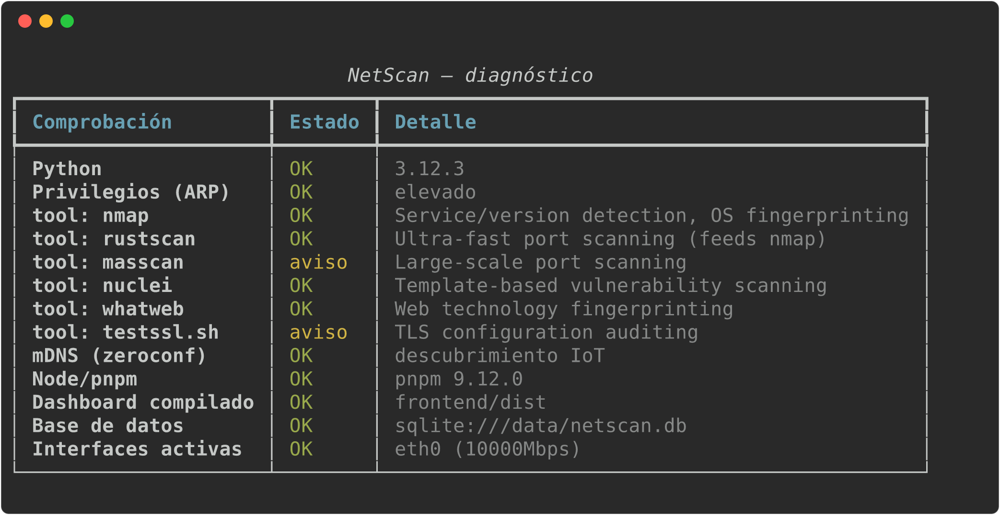
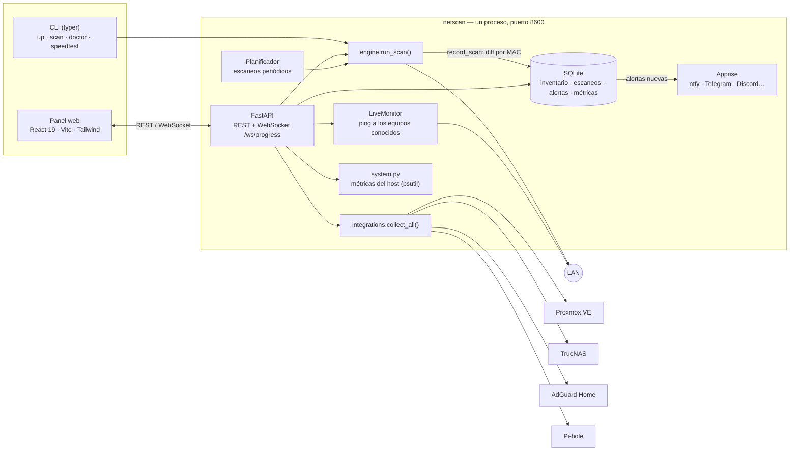
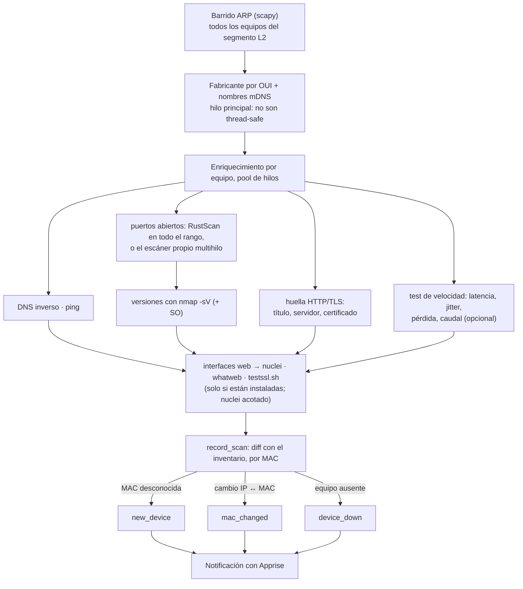

# NetScan — Homelab Network & Systems Monitor

[](https://github.com/abarriuso/netscan/actions/workflows/ci.yml)
[](LICENSE)
[](https://www.python.org/)

[English](README.md) · **Español**

Escáner de red, inventario vivo y panel de monitorización para homelabs, con
integraciones configurables desde la propia web para **Proxmox VE**,
**TrueNAS**, **AdGuard Home**, **Pi-hole** y cualquier servicio propio
(marcador con logo personalizado).

> Del escaneo puntual al vigilante permanente: descubre tu red, detecta
> intrusos, vigila tus hipervisores y tu NAS — todo en un solo dashboard.

> [!WARNING]
> **Proyecto en desarrollo.** NetScan está en desarrollo activo: la API, el
> esquema de la base de datos y la configuración pueden cambiar entre
> versiones sin compatibilidad hacia atrás. Úsalo en tu red local y no
> expongas el dashboard a Internet.

## El dashboard, pestaña a pestaña

El dashboard (`http://localhost:8600`) es una sola página con una cabecera,
nueve pestañas y una terminal acoplada abajo. Solo la pestaña visible consulta
la API; las demás ni siquiera están montadas. El navegador recuerda la última
pestaña que abriste.

> **De dónde salen los datos.** Casi todo lo que sigue se construye a partir
> de dos fuentes: los **escaneos** (descubrimiento + enriquecimiento por
> equipo, a demanda o cada `interval_minutes`, 60 por defecto) y el **monitor
> en vivo** (un sondeo por equipo conocido cada 5 s). Un equipo solo existe
> para NetScan después de que un escaneo lo encuentre; el monitor en vivo no
> descubre hosts nuevos por sí solo. Los paneles que dicen "ejecuta un
> escaneo" están vacíos hasta entonces: es lo esperado, no un fallo.

### Cabecera

- **Logo, nombre y modo de descubrimiento.** La etiqueta indica cómo se
  encuentran los hosts: `descubrimiento ARP` (ejecutándose como
  administrador/root: ARP crudo con scapy) o `barrido ICMP (sin admin)`
  (barrido de ping + la caché ARP del sistema: los mismos hosts en el segmento
  local, algo más lento, rechazado por encima de un /20). `ICMP win-api`,
  `dgram` o `raw` es el backend de los pings (API nativa o sockets ICMP, no un
  proceso `ping` por sondeo); `subprocess` significa que tuvo que recurrir al
  comando `ping` del sistema.
- **Live / Polling / Offline.** Estado del flujo de eventos: WebSocket,
  respaldo por HTTP o API inaccesible.
- Menú **Ejecutar scan** (atajos **R** rápido, **F** completo):
  - *Escaneo rápido* — descubrimiento, DNS inverso, mDNS, los 27 puertos TCP
    más comunes, huella HTTP/TLS de las interfaces web y 5 ecos ICMP por host
    (más `nmap -sV` si está instalado). Unos 20–60 s en una /24.
  - *Escaneo completo* — todo lo anterior sobre 58 puertos TCP, más cada
    herramienta de auditoría instalada (nuclei, whatweb, testssl.sh, cada una
    limitada a 10–20 objetivos). Minutos.
  - *Herramientas sueltas* — ejecuta una sola etapa (solo descubrimiento ARP,
    mDNS, nmap, RustScan, nuclei, whatweb, testssl.sh). Las que no están
    instaladas aparecen deshabilitadas con "no instalado".
- Mientras corre un escaneo la cabecera muestra la etapa, los hosts
  `hechos/total`, el tiempo transcurrido, una ETA lineal durante la etapa por
  host, la última línea del backend (clic para saltar a En vivo) y una
  etiqueta `fallback` si el progreso llega por HTTP polling en lugar de
  WebSocket.
- **ES/EN** cambia el idioma (arranca en el del navegador), **?** repite el
  tutorial y la **llave** abre el diálogo del token de la API.

### 1 · En vivo — "¿está todo arriba ahora mismo?"

- **Seis cifras en vivo**: equipos arriba (y cuántos respondieron al último
  tick), RTT medio de la LAN (equipos que responden ICMP/TCP), RTT del
  gateway, RTT de Internet (a `live_wan_targets`, 1.1.1.1 y 8.8.8.8 por
  defecto), pérdida de Internet en el último minuto, y la cadencia de sondeo
  con la duración del último tick.
- **Gráfica de latencia en vivo** de los últimos minutos (media LAN, gateway,
  Internet y número de equipos que responden), refrescada cada 3 s.
- **Cómo se sondea un equipo:** eco ICMP → conexión TCP a un puerto que ya se
  sabe abierto → ARP (`SendARP` en Windows; en Linux la tabla de vecinos del
  kernel, donde `REACHABLE` cuenta como arriba). El paso ARP demuestra que el
  equipo está, pero no da RTT. Se declara **caído tras 3 sondeos fallidos
  seguidos (15 s)** y vuelve a estar arriba con la primera respuesta. Como
  máximo se sondean 120 equipos por tick (`live_max_devices`).
- **Tablero de uptime**: una fila por equipo con estado actual,
  disponibilidad, barras tipo status page, caídas y cuánto lleva
  arriba/caído. Ventanas **1 h / 24 h / 7 d / 30 d**; filtros *todos / caídos
  / < 99 %*; orden por disponibilidad, nombre, caídas o RTT. Arriba, la
  disponibilidad media de toda la red, la **cobertura** y las caídas en 24 h.
- **Cifras honestas:** la disponibilidad es *sondeos respondidos / sondeos
  enviados mientras NetScan estaba en marcha*. El tiempo con NetScan parado
  sale en gris ("sin datos") y nunca cuenta como caída; la **cobertura** dice
  qué parte de la ventana se observó de verdad. Un "≥" delante de una duración
  significa que el estado empezó antes de que NetScan vigilara ese equipo. Los
  datos se guardan en tramos de 5 minutos durante 35 días.

### 2 · Resumen — la red de un vistazo

- **Tarjetas KPI**, cada una con una cifra real debajo: equipos en línea
  (nuevos en las últimas 24 h), equipos sin verificar, alertas sin leer,
  calidad media (y el peor equipo), latencia media (y p95), último escaneo
  (duración y próximo escaneo programado). Pasa el ratón por una tarjeta para
  ver su fórmula exacta.
- **Estado del sistema** del host de NetScan: CPU por núcleo, RAM/swap,
  discos, tráfico en vivo por interfaz con velocidad de enlace, el proceso de
  NetScan, peticiones servidas, clientes WebSocket, si hay autenticación, si el
  dashboard está compilado, gateway, modo de descubrimiento, próximo escaneo,
  escaneos fallidos y eventos por minuto.
- **Feed de alertas**: equipo nuevo, cambio de IP, equipo caído/recuperado,
  puertos abiertos o cerrados, conflicto de IP y **cambio de MAC del
  gateway**. Filtra las no leídas, marca una o todas como leídas; clic en una
  alerta para abrir ese equipo. Las mismas alertas se envían por Apprise si
  configuraste `notify_urls`.

### 3 · Dispositivos — el inventario

- Una fila por equipo: nombre, IP, MAC (clic en IP/MAC para copiar),
  fabricante, **rol inferido** (gateway, hipervisor, NAS, servidor, PC,
  móvil, impresora, multimedia, cámara, IoT, equipo de red, VM…), latencia,
  jitter, pérdida, **calidad 0–100**, **riesgo 0–100**, puertos abiertos (con
  la versión de `nmap -sV` en el tooltip cuando se conoce) y confianza.
- Columnas ordenables (los valores sin dato siempre van al final) y filtro de
  texto. En el móvil la tabla pasa a tarjetas apiladas que conservan todas las
  métricas.
- Acciones por fila: **marcar como confiable** (quita el factor de riesgo "no
  verificado" y la marca de revisión), **test de velocidad**
  (latencia/jitter/pérdida/handshake TCP a demanda) y **Wake-on-LAN**.
- **Exportar** a CSV o JSON con rol, riesgo y disponibilidad de 24 h.
- Clic en un nombre abre el **perfil del equipo** (ver abajo).

### 4 · Mapa — dónde está cada equipo

- **Radar de latencia**: el gateway en el centro; cada equipo a una distancia
  igual a su RTT en vivo en escala logarítmica (anillos en 0,5 / 1 / 5 / 20 /
  100 ms). Sector y color = rol, tamaño del nodo = puertos abiertos, anillo
  pulsante = riesgo alto/crítico, punto rojo = no confiable, discontinuo =
  desconectado. Arrastra para mover, rueda para hacer zoom, etiquetas por
  nombre, IP o ninguna; clic en un nodo para su perfil.
- **Mapa de direcciones IP** de la subred escaneada: cada dirección coloreada
  como red, broadcast, gateway, este host, en uso (en línea/desconectado) o
  libre, con el porcentaje de ocupación. Admite hasta una /22 (1024
  direcciones).

### 5 · Seguridad — qué está expuesto y por qué importa

- Resumen del **riesgo de la red**: puntuación media, equipos no confiables,
  MACs aleatorias, certificados que caducan en < 30 días.
- **Ranking de riesgo**: cada equipo con su puntuación 0–100 y cada factor
  desglosado con puntos, evidencia y solución. Escala: 0–19 bajo · 20–44 medio
  · 45–69 alto · 70–100 crítico. Los factores son heurísticos y
  transparentes, por ejemplo Telnet (+30), API de Docker / Redis / MongoDB sin
  autenticación, VNC, FTP, RDP, MQTT, SMB, bases de datos accesibles desde la
  LAN, > 10 puertos abiertos, certificados caducados o a punto de caducar, TLS
  < 1.2, certificados autofirmados, páginas de login por HTTP plano, hallazgos
  de nuclei/testssl, conflictos de IP, no confiable, llegó en las últimas
  24 h, MAC aleatoria. El total se limita a 100.
- **Integridad del gateway**: la MAC del gateway se registra en cada escaneo;
  un cambio significa un router sustituido… o ARP spoofing. Los conflictos de
  IP (una IP que responde desde varias MACs) también aparecen aquí.
- **Servicios de riesgo expuestos** agrupados por puerto, **certificados TLS**
  (sujeto, emisor, caducidad, autofirmado) y **hallazgos de los escáneres**.
- **Alcance realista:** es una revisión de exposición de tu LAN, no una
  prueba de penetración. Los hallazgos solo aparecen tras un escaneo
  *completo* con nuclei y/o testssl.sh instalados (testssl.sh y whatweb solo
  funcionan en Linux/WSL).

### 6 · Analítica — cómo evoluciona la red

- **Tendencias en el tiempo**, un punto por escaneo: latencia media, calidad
  media, throughput medio, equipos por escaneo, pérdida de paquetes y equipos
  que responden ICMP. Necesita al menos 2 escaneos; se guardan los últimos
  200.
- **Top de fabricantes, sistemas operativos y puertos abiertos** de todo el
  inventario (el SO es una estimación de `nmap`/heurística, no una verdad
  absoluta).
- **Servicios web y TLS**: cada interfaz web encontrada en el último escaneo
  con su título, servidor, estado del certificado (válido/caducado, días
  restantes, autofirmado) y sus hallazgos de seguridad.

### 7 · Herramientas — diagnóstico desde el host de NetScan

Todo se ejecuta en el **servidor**, así que los resultados muestran la red
vista desde la máquina que ejecuta NetScan, no desde tu navegador. No hacen
falta binarios externos, y cada sondeo se emite también a la terminal (filtro
"tools").

| Herramienta | Qué hace |
|---|---|
| Ping | Ecos ICMP nativos: mín/media/máx, desviación, jitter, pérdida |
| Traceroute | ICMP con TTL limitado salto a salto con RTT y nombres inversos (hasta 30 saltos) |
| Tiempos HTTP | GET con fases DNS / TCP / TLS / TTFB / transferencia, código, cabeceras clave y cabeceras de seguridad que faltan |
| Inspector TLS | Protocolo, cifrado, ALPN, tiempo de handshake, confianza de la cadena (almacén del sistema), SANs, clave, caducidad |
| Consulta DNS | Cualquier tipo de registro contra cualquier resolver, cronometrado (cliente RFC 1035 propio) |
| Benchmark de resolvers | La misma consulta al gateway, tu AdGuard/Pi-hole y 1.1.1.1 / 8.8.8.8 / 9.9.9.9 — mediana de 3 |
| Comprobación TCP | Tiempo de handshake a un puerto (×3) y el banner, si lo envía |
| Escaneo de puertos | Escaneo TCP connect de **una IPv4 privada** (solo RFC 1918, máximo 4096 puertos); vacío = los 58 puertos por defecto |
| Calculadora de subred | Red, máscara, wildcard, broadcast y rango de hosts de un CIDR |
| Consulta de MAC | Fabricante (OUI), detección de MAC aleatoria/privada y de NIC virtual |

### 8 · Integraciones — los servicios de tu homelab

- **Proxmox VE** (varios nodos/clústeres): invitados (VMs y CTs) con estado,
  vCPUs y memoria (se listan los 8 primeros), invitados en marcha/total y
  versión de PVE.
- **TrueNAS** CORE/SCALE: pools con capacidad usada y salud, y alertas del
  sistema. (La API también recoge discos y resultados SMART; el panel todavía
  no los dibuja.)
- **AdGuard Home**: consultas de hoy, bloqueadas, tasa de bloqueo, tiempo
  medio de procesamiento, clientes.
- **Pi-hole** (API v6): consultas, bloqueadas, dominios en la lista de
  bloqueo, clientes activos / totales.
- **Marcadores propios**: nombre, URL y tu propio logo (PNG/SVG/JPG/WEBP,
  máx. 2 MB) con comprobación de arriba/caído.
- Se añaden, editan y borran **desde la web**, sin tocar el YAML. Las
  instancias definidas en `netscan.yaml` aparecen como "definido en config" y
  aquí son de solo lectura. Los paneles se refrescan cada 30 s mientras la
  pestaña está abierta; un error muestra el motivo (DNS, TLS, auth…).

### 9 · Sistema — ¿está sano el propio NetScan?

- **Toolchain y capacidades**: qué herramientas externas están instaladas
  (nmap, RustScan, nuclei, whatweb, testssl.sh, masscan), su versión, licencia
  y para qué sirven. `masscan` se detecta pero el motor aún no lo usa.
- **Consola en vivo**: las últimas 300 líneas de `netscan.log`, refrescadas
  cada 5 s.

### Terminal (tecla `` ` ``)

Un panel acoplado abajo en todas las pestañas con **todos los eventos**: cada
sondeo ARP/ICMP, puerto abierto, respuesta DNS, petición HTTP, certificado, la
línea de comando exacta de cada herramienta externa, los ticks del monitor y
las llamadas a la API (**BE**), mezclados con cada petición que hace tu
navegador (**FE**). Filtra por grupo (scan, puertos, web/tls, dns/icmp, live,
api, navegador, alertas, herramientas, logs) y nivel mínimo, busca por texto o
`/regex/`, pausa, limpia y descarga como `.log` para un informe de fallo.

### Perfil del equipo

Se abre desde el nombre de un equipo, un nodo del mapa, una alerta o el
ranking de riesgo. Pestañas: **resumen** (rol y los motivos, tipo de MAC —
fabricante, aleatoria o NIC virtual —, primera/última vez visto, notas
editables), **uptime** (barras de 24 h, caídas, caída más larga),
**métricas** (historial de latencia/calidad/pérdida, un punto por escaneo o
test de velocidad), **servicios** (puertos con versiones de `nmap -sV`,
interfaces web y certificados), **riesgo** (cada factor con evidencia y
solución) y **línea temporal** (cada evento registrado de ese equipo).

### Tutorial de primera visita

En la primera visita un **tutorial guiado** (foco sobre cada elemento,
contador de misiones, diálogo que se escribe solo; → / Enter, ← y Esc) recorre
todas las secciones y ofrece lanzar el primer escaneo rápido. Repítelo cuando
quieras con el botón **?**.

Cada número tiene unidad y fórmula definidas: ver
[docs/METRICS.md](docs/METRICS.md) (en inglés).

`netscan.sh doctor` / `netscan.bat doctor` — diagnóstico de un vistazo antes de arrancar:

<p align="center">
  
</p>

```
┌────────────────────────────────────────────────────────────────┐
│  backend/   Python 3.11+ · FastAPI · SQLite · scapy            │
│  frontend/  React 19 · TypeScript · Vite · Tailwind · shadcn   │
│  CI/CD      GitHub Actions (lint · mypy · pytest · build)      │
│  Licencia   GPL-2.0-or-later                                   │
└────────────────────────────────────────────────────────────────┘
```

## Instalación en un comando

**Windows:**

```bat
install.bat --run
```

**Linux / macOS / WSL:**

```bash
chmod +x install.sh netscan.sh && ./install.sh --run
```

Cada uno hace TODO: comprueba/instala Python y Node si faltan, crea el
entorno virtual, instala el backend, las herramientas externas que puede
(`nmap`, `RustScan`, `nuclei`…), compila el dashboard y lo arranca —
`http://localhost:8600` se abre solo. No hay un segundo paso manual. Detalle
completo, opciones (`--minimal`, `--system`, instalador de Windows,
Docker, WSL con las 6 herramientas) en [Arranque rápido](#arranque-rápido-un-solo-comando).

## Qué hace

**Descubrimiento y fingerprinting**
- ARP scan (scapy) con lookup de vendor por OUI — o, **sin permisos de
  administrador**, barrido ICMP + caché ARP del sistema (mismo resultado en el
  segmento local)
- ICMP nativo (`IcmpSendEcho` en Windows, sockets ICMP en Linux/macOS): RTT por
  debajo del milisegundo, sin lanzar un proceso `ping` por sondeo
- Rol inferido por equipo (gateway, hipervisor, NAS, servidor, PC, móvil,
  impresora, multimedia, cámara, IoT, equipo de red, VM) con sus motivos
- mDNS/Bonjour (zeroconf) para nombrar IoT que no responden a DNS inverso
- Escaneo de puertos multihilo + heurística de OS
- Fingerprint HTTP/TLS de las web UIs: título, `Server`, emisor del
  certificado, caducidad y autofirmados
- Integración opcional de herramientas externas con **detección automática y
  degradación elegante**: `nmap -sV` para versiones reales de servicio,
  RustScan, nuclei, whatweb, testssl.sh (ver [Licencias](#licencias))

**Monitorización en vivo y uptime**
- Cada equipo se sondea cada 5 s (ICMP → TCP → ARP); caído tras 3 fallos seguidos
- Disponibilidad, cobertura, caídas y MTTR por equipo; RTT y pérdida del
  gateway y de Internet para distinguir "mi LAN" de "mi operador"
- Endpoint Prometheus `/metrics` para Grafana

**Seguridad**
- Riesgo 0–100 por equipo con factores desglosados (servicios de riesgo, TLS,
  certificados, hallazgos de nuclei/testssl, confianza, MACs aleatorias)
- Alertas de puertos abiertos/cerrados, conflictos de IP y **cambio de MAC del
  gateway** (el indicio de ARP spoofing)

**Inventario vivo (SQLite)**
- Cada escaneo se compara con el inventario persistido; historial por equipo
- Alertas de **dispositivo nuevo** (detección de intrusos casera), cambio de
  IP↔MAC y dispositivo caído/de vuelta
- Marca dispositivos como "de confianza" desde el dashboard
- Notificaciones vía Apprise: ntfy, Telegram, Discord y +80 servicios

**Integraciones homelab**
- **Proxmox VE** (múltiples nodos/clusters): estado de VMs y CTs
- **TrueNAS** CORE/SCALE: pools y alertas del sistema (la API recoge también
  discos y resultados SMART, pero el panel aún no los dibuja)
- **AdGuard Home** y **Pi-hole** (API v6): consultas DNS, bloqueos, clientes
  (cruzable con el inventario de red)
- Marcadores personalizados para cualquier otro servicio: nombre, URL y
  logo propio, con comprobación de arriba/abajo
- Todo se añade, edita y borra **desde la propia web** — sin tocar
  `netscan.yaml` a mano (las instancias definidas ahí siguen funcionando,
  de solo lectura en el panel)

**Speed test y métricas de calidad (nuevo)**
- Test de velocidad por dispositivo: **latencia** media/mín/máx, **jitter**,
  **pérdida de paquetes**, **tiempo de handshake TCP por puerto** y, opcional,
  **throughput real (Mbps)** por HTTP
- Puntuación de **calidad 0–100** por dispositivo e histórico de muestras
- Botón de speed test bajo demanda en cada fila del dashboard

**Estado del sistema (nuevo)**
- Panel con el estado del **terminal server (backend)** y del **frontend**:
  uptime, peticiones servidas, escaneos, clientes WebSocket, auth, scheduler
- Métricas del host vía `psutil`: CPU (por núcleo), RAM/swap, discos, y
  **tráfico en vivo por interfaz** (↓/↑), con **link speed** del adaptador
- Medidores y contadores **animados** (sin parpadeos; respeta `prefers-reduced-motion`)

**Dashboard**
- Tabla densa de dispositivos con puertos, latencia/jitter/pérdida/calidad,
  tooltips de versión y filtrado
- **Columnas ordenables** (host/IP/latencia/jitter/pérdida/calidad; los valores
  sin dato caen siempre al final) y, en móvil, tarjetas apiladas que conservan
  todas las métricas en vez de ocultar columnas
- **Microinteracciones** en clave terminal: IP/MAC copiables al clic con
  confirmación, respuesta física en botones, tick de columna activa y entrada
  escalonada de filas — todo respeta `prefers-reduced-motion`
- Paneles de Proxmox/TrueNAS/AdGuard/Pi-hole con salud de pools y guests, más
  gestor de integraciones (alta/edición/borrado) y marcadores personalizados
- Progreso de escaneo en vivo por WebSocket, con aviso visible si cae a sondeo HTTP
- Feed de alertas con acknowledge
- Avisos (toasts) con el mensaje real de la API en cada acción (trust, speed
  test, Wake-on-LAN, copiar)
- Interfaz en inglés y en español, con selector en la cabecera (arranca en el
  idioma del navegador)

## Cómo funciona

Un único proceso sirve la API, el panel y las tareas en segundo plano; la CLI
llama directamente al mismo motor de escaneo. Más detalle y las decisiones de
diseño en [docs/ARCHITECTURE.md](docs/ARCHITECTURE.md).



Qué hace un escaneo, etapa a etapa (cada herramienta opcional se salta sin
error si no está instalada):



## Arranque rápido — un solo comando

Tras instalar, **`netscan up`** arranca la API **y** el dashboard integrado en
un único proceso y puerto (`http://localhost:8600`) y abre el navegador.

**Windows:**

```bat
install.bat --run
```

Instala Python/Node (vía winget si faltan), crea el venv, instala el backend,
las herramientas externas (nmap, RustScan, nuclei, Npcap), **compila el
dashboard** y con `--run` lo lanza. Luego basta con:

```bat
netscan.bat up            REM  API + dashboard + navegador (auto-elevado)
```

`install.bat --minimal` omite las herramientas externas. Sin argumentos,
`netscan.bat` ya ejecuta `up`.

**Linux / macOS:**

```bash
chmod +x install.sh netscan.sh
./install.sh --run        # instala todo y lanza (o ./install.sh a secas)
./netscan.sh up           # API + dashboard + navegador (se auto-eleva con sudo)
```

`./install.sh` detecta apt/dnf/pacman/brew para las dependencias del sistema y
degrada con elegancia lo que no pueda instalar.

**Instalador de Windows (programa normal):**

```bat
winget install JRSoftware.InnoSetup
iscc packaging\windows\netscan.iss        REM  -> packaging\windows\Output\NetScan-Setup.exe
```

`NetScan-Setup.exe` aparece en "Agregar o quitar programas", crea accesos en
el menú Inicio y deja todo listo. En CI lo compila `installer.yml`
(`workflow_dispatch` o reutilizado por `release.yml`), que también genera el
paquete Linux (`.tar.gz` con backend + `frontend/dist` + `install.sh`) y
adjunta ambos, junto al paquete Python, a cada release de un tag `v*`.

> **¿Una herramienta no aparece como disponible en `netscan doctor` /
> `netscan caps` justo después de instalarla?** En Windows, escribir el PATH
> de usuario no actualiza por sí solo las ventanas ya abiertas ni los accesos
> directos existentes — cierra y reabre la terminal (o el dashboard) antes de
> reportarlo como bug. `install.bat` ya lo hace por ti en la misma ejecución;
> solo afecta a una `netscan.bat`/consola abierta *antes* de instalar.

### Windows con las 6 herramientas — todo lo que ves aquí, funciona

Hay **6 herramientas externas** que NetScan sabe usar: `nmap`, `RustScan`,
`nuclei`, `whatweb`, `testssl.sh` y `masscan` (esta última detectada pero
sin usar todavía). Todas están **conectadas de verdad al motor de escaneo**
— no es solo un indicador visual, cada una hace algo real cuando la lanzas
desde el menú "acciones" del dashboard o desde `netscan scan --full`.

El problema es que **`install.bat` (Windows nativo) solo puede instalar 3
de las 6**: `nmap`, `RustScan` y `nuclei` tienen forma de instalarse en
Windows (winget, o descarga verificada por SHA256). `whatweb` y
`testssl.sh` **no la tienen** — son herramientas Linux (una gema de Ruby,
un script bash sobre OpenSSL) sin equivalente nativo de Windows. Y
`masscan`, aunque compila en Windows, no tiene paquete winget mantenido, así
que tampoco se instala solo.

**¿Cuál es la solución?** Ejecutar NetScan dentro de **WSL** (Linux dentro
de Windows) en vez del NetScan nativo de Windows. Ahí sí puede instalar las
6. Esto es dos pasos separados — primero WSL, luego NetScan dentro:

**1. Instala WSL (una vez, si no lo tienes ya):**

Abre PowerShell **como administrador** (clic derecho → "Ejecutar como
administrador") y escribe:

```powershell
wsl --install
```

Esto instala Ubuntu por defecto. Si te pide reiniciar el PC, reinicia.
Después de reiniciar (o si no hacía falta), busca **"Ubuntu"** en el menú
de inicio y ábrelo — la primera vez te pedirá crear un usuario y contraseña
de Linux (puedes poner lo que quieras, no tiene que coincidir con tu cuenta
de Windows). Eso ya es tu terminal de Linux, integrada en Windows.

**2. Dentro de esa ventana de Ubuntu, instala las herramientas:**

Copia y pega esto (una línea, luego Enter; te pedirá la contraseña que
acabas de crear):

```bash
sudo apt update && sudo apt install -y whatweb testssl.sh nmap masscan
```

Si `testssl.sh` no aparece disponible en tu versión de Ubuntu (algunas
versiones no lo traen empaquetado), instálalo así en su lugar:

```bash
git clone --depth 1 https://github.com/drwetter/testssl.sh.git ~/testssl.sh
sudo ln -s ~/testssl.sh/testssl.sh /usr/local/bin/testssl.sh
```

**3. Arranca NetScan desde dentro de WSL** (no desde `netscan.bat` — ese es
solo para el NetScan nativo de Windows). Tu disco `C:\` se ve desde WSL en
`/mnt/c/`, así que entras al mismo repo que ya tienes:

```bash
cd /mnt/c/ruta/a/netscan
./install.sh
./netscan.sh up
```

`./install.sh` instala RustScan y nuclei igual que hace `install.bat` en
Windows (y detecta que `whatweb`/`testssl.sh` ya están, del paso 2), y crea
su propio entorno virtual en `backend/.venv-linux` — **separado** del
`backend/.venv` que usa Windows, aunque sea el mismo checkout de repo visto
desde `/mnt/c/`. Un venv de Windows (`Scripts/python.exe`) y uno de Linux
(`bin/python`) no pueden compartir carpeta sin corromperse mutuamente; por
eso van cada uno en la suya. `./netscan.sh up` arranca la API + el
dashboard. El navegador se abre solo; si no, entra tú a
`http://localhost:8600` — WSL2 comparte red con Windows, así que funciona
igual que si NetScan corriera nativo.

Si `python3 -m venv` falla con `ensurepip is not available` (Ubuntu separa
el módulo `venv` en un paquete aparte), `install.sh` ya lo detecta e
instala automáticamente el paquete que falta (`python3.XX-venv`) y
reintenta — no hace falta nada manual.

**4. Comprueba que las ves todas:**

```bash
./netscan.sh doctor
```

Deberías ver las 6 en verde (o "OK") salvo `masscan`, que aparece detectada
pero el motor todavía no la usa (ver tabla más abajo).

> **Nota importante**: esto son dos NetScan *separados* — el nativo de
> Windows (`netscan.bat`, con 3 herramientas) y el de WSL
> (`netscan.sh`, con las 6). No hace falta desinstalar el de Windows; usa
> el que necesites en cada momento. Si quieres que WSL arranque solo al
> encender el PC, puedes crear una tarea programada de Windows que lance
> `wsl ./netscan.sh up --no-browser`, pero eso ya es opcional.

| Herramienta | Windows nativo (`install.bat`) | WSL (`install.sh`) | ¿El motor la usa? |
|---|---|---|---|
| nmap | ✅ | ✅ | Sí |
| RustScan | ✅ | ✅ | Sí |
| nuclei | ✅ | ✅ | Sí |
| whatweb | ❌ | ✅ | Sí |
| testssl.sh | ❌ | ✅ | Sí |
| masscan | ❌ | ✅ (vía apt) | No — detectada, sin cablear al motor todavía |

### Servicio web en Linux (systemd)

Para dejar NetScan como **servicio web** accesible en la LAN:

```bash
./install.sh --system
```

Esto crea `/etc/netscan/netscan.env` (bind a `0.0.0.0:8600` + **token de API
generado**), instala la unidad `netscan.service` con las capacidades de red
necesarias (`CAP_NET_RAW`) y la arranca. El dashboard queda en
`http://<ip-del-servidor>:8600/`.

```bash
systemctl status netscan        # estado del servicio
journalctl -u netscan -f        # logs en vivo
cat /etc/netscan/netscan.env    # recuperar el token si ya no lo tienes a mano
```

La primera vez que el dashboard hace una petición sin token válido, se abre
solo un diálogo pidiéndolo (guardado luego en el navegador); también puedes
abrirlo cuando quieras con el icono de llave 🔑 del header, por ejemplo para
cambiarlo tras rotar el token.

Manual (sin systemd), como servicio en primer plano:

```bash
NETSCAN_API_HOST=0.0.0.0 NETSCAN_API_TOKEN=mi-token \
  ./netscan.sh up --no-browser --port 8600
```

Otros comandos útiles: `netscan speedtest` (test de velocidad de la red),
`netscan doctor` (diagnóstico completo), `netscan scan --full`.

### Proxmox LXC (un comando desde el host)

Para correr NetScan en su propio contenedor, visible desde toda la LAN,
desde la **shell del host Proxmox** (no dentro de un contenedor):

```bash
curl -fsSLO https://raw.githubusercontent.com/abarriuso/netscan/main/packaging/proxmox/create-lxc.sh
curl -fsSLO https://raw.githubusercontent.com/abarriuso/netscan/main/packaging/proxmox/bootstrap-lxc.sh
chmod +x create-lxc.sh
./create-lxc.sh
```

(`bootstrap-lxc.sh` tiene que quedar junto a `create-lxc.sh` — el segundo
lo copia dentro del contenedor nuevo automáticamente; no hace falta
ejecutarlo tú.) Si prefieres no dejar ni esos dos ficheros en el host, hay
un one-liner que no descarga nada permanente — al no encontrar
`bootstrap-lxc.sh` junto a sí mismo, lo baja solo a un temporal en `/tmp`:

```bash
VMID=201 OS_TEMPLATE=ubuntu-26.04-standard bash -c "$(curl -fsSL https://raw.githubusercontent.com/abarriuso/netscan/main/packaging/proxmox/create-lxc.sh)"
```

Y si ya descargaste los dos ficheros y quieres limpiar después,
sea cual sea la forma en que lo ejecutaste:

```bash
rm -f create-lxc.sh bootstrap-lxc.sh
```

Si lo lanzas a mano en una terminal, te pregunta VMID, nombre, plantilla,
bridge e IP uno a uno (Enter para aceptar el valor por defecto que
propone). Cualquiera de esos que ya venga fijado por variable de entorno
no se pregunta; y si no hay una terminal real de por medio (lo lanzas
desde un pipe o algo automatizado), tampoco pregunta nada — usa los
valores por defecto sin más, para no quedarse colgado. Crea un CT sin
privilegiar (**Ubuntu 26.04 LTS** por defecto — cualquier plantilla
Debian/Ubuntu vale, ver `OS_TEMPLATE`; 2 vCPU / **2GB de RAM** — 1GB se
queda corto y el `oom-kill` se lleva por delante al servicio a mitad de
instalación, sobre todo durante el build del dashboard), lo arranca,
clona el repo dentro y ejecuta `install.sh --system` — al terminar
imprime la URL del dashboard y dónde está el token. Todo se puede
ajustar también por variable de entorno (`VMID`, `CT_NAME`, `BRIDGE`,
`IP`, `CORES`, `MEMORY_MB`, `OS_TEMPLATE`, ...); ver los comentarios de
cabecera de `packaging/proxmox/create-lxc.sh` para el detalle completo.
Por ejemplo, para usar Debian 12 en vez de Ubuntu sin que te pregunte
nada:

```bash
OS_TEMPLATE=debian-12-standard ./create-lxc.sh
```

Todo el proceso es desatendido de verdad: `install.sh`/`bootstrap-lxc.sh`
ya silencian el diálogo interactivo de `needrestart` que trae Debian/Ubuntu
(sin eso, un `apt-get install` de en medio se queda colgado para siempre
sin dar ningún error, esperando una tecla que nunca llega por `pct exec`),
e instalan Node.js 20+ solos si el contenedor no lo trae (una plantilla
LXC pelada nunca lo trae) para poder compilar el dashboard.

**El único ajuste que de verdad importa:** `BRIDGE` (por defecto `vmbr0`)
tiene que ser un bridge conectado a tu LAN física, no NAT ni una zona SDN
aislada — el escaneo ARP solo descubre lo que está en su mismo segmento
L2. Eso se decide al crear el contenedor; no hay forma de arreglarlo desde
dentro después.

Si ya tienes un CT/VM Linux creado (con red bien conectada) y solo quieres
la parte de instalación, basta con `bootstrap-lxc.sh` a solas, ejecutado
como root dentro del contenedor:

```bash
curl -fsSL https://raw.githubusercontent.com/abarriuso/netscan/main/packaging/proxmox/bootstrap-lxc.sh | bash
```

### Docker (host Linux)

```bash
cp netscan.example.yaml netscan.yaml
docker compose up --build -d
# API + dashboard en http://localhost:8600
```

Una sola imagen compila el dashboard y lo sirve junto a la API en el puerto
8600, igual que `netscan up`. El contenedor usa la red del host
(`network_mode: host`) para que el escaneo ARP vea tu LAN, lo que exige un host
Docker **Linux**; en Docker Desktop (Windows/macOS) usa la instalación nativa o
WSL.

Por defecto solo escucha en `127.0.0.1`. Para abrir el dashboard a otros
equipos, pon estas dos variables en un `.env` junto a `docker-compose.yml`:

```bash
NETSCAN_API_HOST=0.0.0.0
NETSCAN_API_TOKEN=un-token-largo-y-aleatorio
```

## Configuración

Toda la configuración vive en `netscan.yaml` (ver `netscan.example.yaml`) y
puede sobreescribirse con variables de entorno `NETSCAN_*`:

```bash
NETSCAN_PROXMOX__0__TOKEN_SECRET=xxxx   # secreto del token de pve1
NETSCAN_TRUENAS__0__API_KEY=xxxx
NETSCAN_NOTIFY_URLS__0=ntfy://ntfy.sh/mi-topic
```

`netscan.yaml` y `config.local.yaml` están git-ignored, pero los secretos deben
ir **siempre** en variables de entorno, nunca en el YAML.

### Credenciales necesarias

| Servicio | Qué crear | Dónde |
|---|---|---|
| Proxmox VE | API Token (`PVEAPIToken`) | Datacenter → Permissions → API Tokens |
| TrueNAS | API Key | UI → Credentials → API Keys |
| AdGuard Home | usuario/contraseña de la web UI | — |
| Pi-hole | contraseña de administrador | — (API v6) |

## API REST (extracto)

| Endpoint | Descripción |
|---|---|
| `POST /api/scans` | Lanza un escaneo (`{"full": true}`) |
| `GET /api/scans/latest` | Último resultado completo |
| `GET /api/scans/progress` · `WS /ws/progress` | Progreso en vivo |
| `GET /api/devices` · `PATCH /api/devices/{mac}` | Inventario y trust |
| `GET /api/alerts` · `POST /api/alerts/{id}/ack` | Alertas |
| `GET /api/integrations/proxmox\|truenas\|adguard\|pihole\|custom` | Salud de integraciones |
| `GET /api/overview` · `GET /api/capabilities` | Resumen y toolchain |
| `GET /api/system` · `GET /api/status` | Estado del server/host/frontend (todo en uno) |
| `GET /api/metrics/summary` | Métricas de calidad agregadas |
| `GET /api/devices/{mac}/metrics` | Histórico de latencia/jitter/calidad |
| `POST /api/devices/{mac}/speedtest` | Speed test bajo demanda de un dispositivo |
| `POST /api/devices/{mac}/wake` | Wake-on-LAN |
| `GET /api/devices/{mac}/profile` · `/timeline` · `/uptime` | Todo lo conocido de un equipo, su historial, su disponibilidad |
| `GET /api/live` | Instantánea del monitor en vivo (estado por equipo, series LAN/gateway/WAN) |
| `GET /api/uptime?hours=24&slots=48` | Disponibilidad, cobertura, caídas y MTTR por equipo |
| `GET /api/map` · `GET /api/ipmap` | Nodos del mapa (rol, riesgo, RTT) · mapa de direcciones IP |
| `GET /api/security` | Ranking de riesgo, exposición, certificados, hallazgos, integridad del gateway |
| `GET /api/export/devices?format=csv\|json` | Exportación del inventario |
| `GET /api/events?since=N` · `WS /ws/events` | Feed de eventos (la terminal) |
| `POST /api/tools/{ping,traceroute,dns,dns-bench,tcp,portscan,http,tls,subnet,mac}` | Caja de herramientas de diagnóstico |
| `POST /api/alerts/ack-all` | Marca todas las alertas como leídas |
| `GET /metrics` | Exposición Prometheus (segundos, ratios 0–1) |

Con el dashboard compilado, la API **y** la web se sirven en el mismo puerto
(`/` = dashboard, `/api/...` = API). Docs interactivas en
`http://localhost:8600/docs` (OpenAPI).

### Mensajes de error

Toda respuesta de error de la API llega como JSON `{"detail": "..."}` (con
un mensaje legible, en inglés), y el dashboard muestra ese texto directamente en un aviso
(toast) — nunca un código pelado. Un error inesperado del servidor se captura
de forma global y se convierte en un `500` con `detail` legible; el detalle
técnico (traza) queda en el log de NetScan, no en el cliente.

| Código | Significado | Qué mirar |
|---|---|---|
| `400` | Petición mal formada (ej. rango de red inválido) | Revisa el cuerpo/parámetros de la petición |
| `401` | Falta el token o es incorrecto | Configura el token en el dashboard (icono de llave) o `NETSCAN_API_TOKEN` |
| `403` | Origen no permitido (CORS) | Añade el origen a `NETSCAN_API_CORS_ORIGINS` |
| `404` | Recurso inexistente (ej. aún no hay ningún scan) | Lanza un scan; comprueba la MAC/ruta |
| `409` | Conflicto (ej. ya hay un scan en curso) | Espera a que termine el scan activo |
| `413` | Fichero demasiado grande (ej. logo de integración) | El logo no puede superar 2 MB |
| `415` | Tipo de contenido no soportado | Sube PNG/JPG/SVG para el logo |
| `422` | Validación de campos fallida | El `detail` lista qué campo falla |
| `429` | Demasiadas peticiones | Baja la frecuencia de sondeo o espera |
| `500` | Error interno no controlado | Revisa los logs de NetScan (ver abajo) |

## Resolución de problemas

- **El dashboard carga en blanco / no aparecen datos.** Comprueba que la API
  responde: `curl http://localhost:8600/api/health` debe devolver
  `{"status":"ok"}`. Si no, el servicio no está arrancado (ver systemd abajo).
- **`401` al abrir el dashboard.** Hay un token configurado en el servidor pero
  el navegador no lo tiene. Pulsa el icono de llave en la cabecera e introdúcelo;
  se guarda en el navegador. El token es `NETSCAN_API_TOKEN`.
- **El puerto ya está en uso.** Cambia `NETSCAN_API_PORT` (y `NETSCAN_API_HOST`
  si solo quieres escuchar en localhost). En Linux: `ss -tlnp | grep 8600` para
  ver qué lo ocupa.
- **El escaneo ARP no encuentra dispositivos.** Sin privilegios, NetScan pasa
  solo a barrido ICMP + caché ARP del sistema (la cabecera muestra "barrido
  ICMP (sin admin)"); cubre el segmento local pero rechaza redes mayores de una
  /20. El ARP en crudo necesita privilegios (en Linux, `cap_net_raw` o root; el
  servicio systemd ya lo concede). En LXC, el contenedor debe estar en modo
  bridge sobre la misma VLAN que quieres escanear.
- **¿Qué está haciendo NetScan ahora mismo?** Abre la terminal (tecla `` ` ``):
  cada sondeo, petición y comando está ahí con su tiempo. Filtra por origen o
  nivel, o expórtala como `.log` para reportar un fallo.
- **`403` / errores de CORS desde otro equipo.** Añade el origen del navegador
  (ej. `http://192.168.1.50:3000`) a `NETSCAN_API_CORS_ORIGINS` (lista separada
  por comas).
- **Una integración (Proxmox/TrueNAS/AdGuard) sale en rojo.** Verifica URL,
  credenciales y que el destino sea alcanzable desde el host de NetScan. El
  `detail` del error de la integración dice qué falló (DNS, TLS, auth…).
- **¿Dónde están los logs?** En `NETSCAN_DATA_DIR/netscan.log` (además de la
  salida estándar). Con systemd: `journalctl -u netscan -f`.

## Desarrollo

```bash
cd backend
pytest                    # suite completa
ruff check .              # lint
ruff format --check .     # formato
mypy src/netscan          # tipos

cd ../frontend
pnpm lint && pnpm typecheck && pnpm build
```

CI en `.github/workflows/ci.yml`: matriz Ubuntu/Windows × Python 3.11/3.12,
lint+build del frontend, chequeo de licencias de dependencias, auditoría de
vulnerabilidades (`pip-audit` + `pnpm audit`) y releases automáticos al
pushear tags `v*` (backend + instalador Windows + bundle Linux, ver
`release.yml`).

## Estructura

```
├── backend/src/netscan/
│   ├── scanner/        # discovery (ARP/barrido), icmp, enrich, mDNS, fingerprint, tools, speed, engine
│   ├── events.py       # bus de eventos de la terminal (/ws/events)
│   ├── live.py         # monitor en vivo: cadena de sondas, histéresis, buckets de uptime
│   ├── insights.py     # uptime, mapa, mapa de IPs, informe de seguridad, Prometheus
│   ├── classify.py · security.py · diag.py   # roles · riesgo · herramientas
│   ├── db/             # SQLModel: inventario, escaneos, alertas, muestras de métricas
│   ├── integrations/   # proxmox · truenas · adguard · pihole
│   ├── api/            # FastAPI + WebSocket + scheduler + estático del dashboard
│   ├── alerts/         # Apprise
│   ├── system.py       # estado del host/proceso/frontend (psutil)
│   ├── config.py       # YAML + env (pydantic-settings)
│   └── cli.py          # typer: up · scan · speedtest · doctor · caps · serve · wake
├── frontend/src/
│   ├── sections/       # Header, StatCards, SystemStatus, DevicesTable, Integrations…
│   ├── components/     # Logo, HeroTitle, metrics.tsx (número animado, medidor, badge de calidad)
│   ├── hooks/          # polling + WebSocket + animaciones
│   └── lib/api.ts      # cliente REST/WS
├── packaging/
│   ├── windows/        # netscan.iss (Inno Setup → NetScan-Setup.exe)
│   └── linux/          # netscan.service (systemd) · netscan.desktop
├── install.sh · netscan.sh   # instalador y lanzador Linux/macOS
├── install.bat · netscan.bat # instalador y lanzador Windows
├── docker/             # Dockerfile: API + dashboard en una sola imagen
├── legacy/             # netscan.py original (referencia histórica)
└── .github/workflows/  # CI + release + installer + dependabot
```

## Licencias

NetScan se distribuye bajo **GPL-2.0-or-later** (requerido por scapy,
GPL-2.0-only). Las dependencias importadas son compatibles (MIT/BSD/Apache/
LGPL). Las herramientas GPL/AGPL/NPSL (nmap, RustScan, masscan, nuclei,
whatweb, testssl.sh) **no se distribuyen**: se invocan como procesos externos
cuando están instaladas ("mere aggregation"), y cada función degrada con
elegancia si la herramienta no está presente. Atribución completa en
[NOTICE](NOTICE).

## Contribuir

Ver [CONTRIBUTING.md](docs/CONTRIBUTING.md). Issues y PRs bienvenidos.

