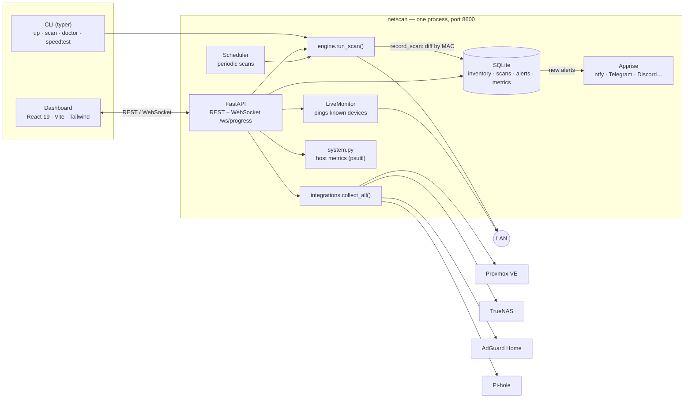
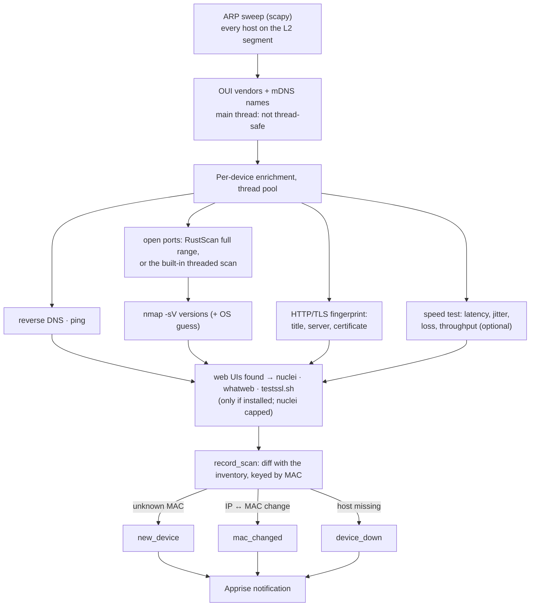

# NetScan — Homelab Network & Systems Monitor

[](https://github.com/abarriuso/netscan/actions/workflows/ci.yml)
[](LICENSE)
[](https://www.python.org/)

**English** · [Español](README.es.md)

Network scanner, live inventory and monitoring dashboard for homelabs, with
integrations you configure from the web itself for **Proxmox VE**,
**TrueNAS**, **AdGuard Home**, **Pi-hole** and any service of your own
(a bookmark with a custom logo).

> From one-off scans to a permanent watch: discover your network, spot
> intruders, keep an eye on your hypervisors and your NAS — all in one dashboard.

> [!WARNING]
> **Work in progress.** NetScan is under active development: the API, the
> database schema and the configuration may change between versions without
> backwards compatibility. Use it on your local network and do not expose the
> dashboard to the Internet.

## The dashboard, tab by tab

The dashboard (`http://localhost:8600`) is a single page with a header, nine
tabs and a terminal docked at the bottom. Only the visible tab polls the API;
the others are not even mounted. The last tab you opened is remembered in the
browser.

> **Where the data comes from.** Almost everything below is built from two
> sources: **scans** (discovery + per-device enrichment, on demand or every
> `interval_minutes`, 60 by default) and the **live monitor** (one probe per
> known device every 5 s). A device only exists for NetScan after a scan has
> found it; the live monitor never discovers new hosts by itself. Panels that
> say "run a scan" are empty until then — that is expected, not a bug.

### Header

- **Logo, name and discovery mode.** The badge says how hosts are found:
  `ARP discovery` (running as admin/root: raw ARP with scapy) or
  `ICMP sweep (no admin)` (ping sweep + the OS ARP cache — same hosts on the
  local segment, a bit slower, refused above a /20). `ICMP win-api`,
  `dgram` or `raw` is the backend used for pings (native API or ICMP
  sockets, not one `ping` process per probe); `subprocess` means it had to
  fall back to the system `ping` command.
- **Live / Polling / Offline.** State of the event stream: WebSocket, HTTP
  fallback, or API unreachable.
- **Run scan** menu (shortcuts **R** quick, **F** full):
  - *Quick scan* — discovery, reverse DNS, mDNS, the 27 most common TCP ports,
    HTTP/TLS fingerprint of web UIs and 5 ICMP echoes per host (plus
    `nmap -sV` if installed). Roughly 20–60 s on a /24.
  - *Full scan* — everything above on 58 TCP ports, plus every audit tool that
    is installed (nuclei, whatweb, testssl.sh, each capped at 10–20 targets).
    Minutes.
  - *Individual tools* — run a single stage (ARP discovery only, mDNS, nmap,
    RustScan, nuclei, whatweb, testssl.sh). Tools that are not installed are
    shown greyed out with "not installed".
- While a scan runs the header shows the stage, `done/total` hosts, elapsed
  time, a linear ETA during the per-host stage, the last backend line (click
  it to jump to Live) and a `fallback` badge if progress is arriving over
  HTTP polling instead of WebSocket.
- **ES/EN** switches the language (it starts in the browser's language),
  **?** replays the tutorial and the **key** opens the API-token dialog.

### 1 · Live — "is everything up right now?"

- **Six live figures**: devices up (and how many answered the last tick), mean
  LAN RTT (devices answering ICMP/TCP), gateway RTT, Internet RTT (to
  `live_wan_targets`, 1.1.1.1 and 8.8.8.8 by default), Internet loss over the
  last minute, and the probe cadence with the duration of the last tick.
- **Live latency chart** of the last minutes (LAN mean, gateway, Internet and
  the number of devices responding), refreshed every 3 s.
- **How a device is probed:** ICMP echo → TCP connect to a port already known
  to be open → ARP (Windows `SendARP`; on Linux the kernel neighbour table,
  where `REACHABLE` counts as up). The ARP step proves the device is there but
  gives no RTT. It is declared **down after 3 consecutive failed
  probes (15 s)** and up again on the first answer. At most 120 devices are
  probed per tick (`live_max_devices`).
- **Uptime board**: one row per device with current state, availability,
  status-page bars, outages and how long it has been up/down. Windows
  **1 h / 24 h / 7 d / 30 d**; filters *all / down / < 99 %*; sort by
  availability, name, outages or RTT. On top, fleet-wide mean availability,
  **coverage** and outages in 24 h.
- **Honest numbers:** availability is *probes answered / probes sent while
  NetScan was running*. Time when NetScan was stopped is grey ("no data") and
  never counted as down; **coverage** tells you how much of the window was
  actually observed. A "≥" in front of a duration means the state started
  before NetScan began watching. Data is kept in 5-minute buckets for 35 days.

### 2 · Overview — the network at a glance

- **KPI cards**, each with a real sub-figure: devices online (new in the last
  24 h), unverified devices, unread alerts, average quality (and the worst
  device), average latency (and p95), last scan (duration and next scheduled
  scan). Hover a card for its exact formula.
- **System status** of the NetScan host: CPU per core, RAM/swap, disks, live
  traffic per interface with link speed, the NetScan process, requests served,
  WebSocket clients, whether auth is on, whether the dashboard is built,
  gateway, discovery mode, next scan, failed scans and events per minute.
- **Alert feed**: new device, IP change, device down/back, ports opened or
  closed, IP conflict and **gateway MAC changed**. Filter unread, mark one or
  all as read; click an alert to open that device. The same alerts are sent
  through Apprise if you configured `notify_urls`.

### 3 · Devices — the inventory

- One row per device: name, IP, MAC (click IP/MAC to copy), vendor, **inferred
  role** (gateway, hypervisor, NAS, server, PC, phone, printer, media, camera,
  IoT, network gear, VM…), latency, jitter, loss, **quality 0–100**, **risk
  0–100**, open ports (with the `nmap -sV` version in the tooltip when known)
  and trust.
- Sortable columns (missing values always go last) and a text filter. On a
  phone the table becomes stacked cards that keep every metric.
- Per-row actions: **mark as trusted** (removes the "untrusted" risk factor and
  the review flag), **speed test** (latency/jitter/loss/TCP handshake on
  demand) and **Wake-on-LAN**.
- **Export** CSV or JSON with role, risk and 24 h availability.
- Clicking a name opens the **device profile** (see below).

### 4 · Map — where every device sits

- **Latency radar**: the gateway in the centre; each device at a distance equal
  to its live RTT on a log scale (rings at 0.5 / 1 / 5 / 20 / 100 ms). Sector
  and colour = role, node size = open ports, pulsing ring = high/critical risk,
  red dot = not trusted, dashed = offline. Drag to pan, wheel to zoom, labels
  by name, IP or none; click a node for its profile.
- **IP address map** of the scanned subnet: every address coloured as network,
  broadcast, gateway, this host, in use (online/offline) or free, with
  utilisation. Supports up to a /22 (1024 addresses).

### 5 · Security — what is exposed and why it matters

- **Network risk** summary: mean score, devices not trusted, randomised MACs,
  certificates expiring in < 30 days.
- **Risk ranking**: every device with its 0–100 score and each factor itemised
  with points, evidence and a fix. Scale: 0–19 low · 20–44 medium · 45–69 high
  · 70–100 critical. The factors are heuristic and transparent, e.g. Telnet
  (+30), Docker API / Redis / MongoDB without auth, VNC, FTP, RDP, MQTT, SMB,
  databases reachable from the LAN, > 10 open ports, expired or soon-to-expire
  certificates, TLS < 1.2, self-signed certificates, login pages over plain
  HTTP, nuclei/testssl findings, IP conflicts, not trusted, joined in the last
  24 h, randomised MAC. The total is capped at 100.
- **Gateway integrity**: the gateway MAC is recorded on every scan; a change
  means a replaced router — or ARP spoofing. IP conflicts (one IP answered from
  several MACs) are listed here too.
- **Exposed risky services** grouped by port, **TLS certificates** (subject,
  issuer, expiry, self-signed) and **scanner findings**.
- **Realistic scope:** this is an exposure review of your LAN, not a
  penetration test. Findings only appear after a *full* scan with nuclei
  and/or testssl.sh installed (testssl.sh and whatweb run on Linux/WSL only).

### 6 · Analytics — how the network evolves

- **Trends over time**, one point per scan: average latency, average quality,
  average throughput, devices per scan, packet loss and devices answering
  ICMP. Needs at least 2 scans; the last 200 scans are kept.
- **Top vendors, operating systems and open ports** across the inventory (the
  OS is an `nmap`/heuristic guess, not ground truth).
- **Web services & TLS**: every web UI found in the last scan with its title,
  server, certificate state (valid/expired, days left, self-signed) and its
  security findings.

### 7 · Tools — diagnostics run from the NetScan host

Everything runs on the **server**, so results show the network as seen from
the machine running NetScan, not from your browser. No external binaries are
needed, and every probe also streams to the terminal (filter "tools").

| Tool | What it does |
|---|---|
| Ping | Native ICMP echoes: min/avg/max, stddev, jitter, loss |
| Traceroute | TTL-limited ICMP hop by hop with RTT and reverse names (up to 30 hops) |
| HTTP timing | GET with DNS / TCP / TLS / TTFB / transfer phases, status, key headers and missing security headers |
| TLS inspector | Protocol, cipher, ALPN, handshake time, chain trust (system store), SANs, key, expiry |
| DNS lookup | Any record type against any resolver, timed (built-in RFC 1035 client) |
| Resolver benchmark | Same query on the gateway, your AdGuard/Pi-hole and 1.1.1.1 / 8.8.8.8 / 9.9.9.9 — median of 3 |
| TCP check | Handshake time to one port (×3) and the banner, if any |
| Port scan | TCP connect scan of **one private IPv4** (RFC 1918 only, at most 4096 ports); empty = the 58 default ports |
| Subnet calculator | Network, mask, wildcard, broadcast and host range of a CIDR |
| MAC lookup | Vendor (OUI), randomised/private and virtual-NIC detection |

### 8 · Integrations — your homelab services

- **Proxmox VE** (several nodes/clusters): guests (VMs and CTs) with state,
  vCPUs and memory (first 8 listed), guests running/total and PVE version.
- **TrueNAS** CORE/SCALE: pools with used capacity and health, and system
  alerts. (The API also collects disks and SMART results; the panel does not
  draw them yet.)
- **AdGuard Home**: queries today, blocked, block rate, average processing
  time, clients.
- **Pi-hole** (API v6): queries, blocked, domains on the blocklist, active /
  total clients.
- **Custom bookmarks**: name, URL and your own logo (PNG/SVG/JPG/WEBP, max
  2 MB) with an up/down check.
- Add, edit and delete them **from the web** — no YAML editing. Instances
  defined in `netscan.yaml` are shown as "defined in config" and are read-only
  here. Panels refresh every 30 s while the tab is open; an error shows the
  reason (DNS, TLS, auth…).

### 9 · System — is NetScan itself healthy?

- **Toolchain & capabilities**: which external tools are installed (nmap,
  RustScan, nuclei, whatweb, testssl.sh, masscan), their version, licence and
  purpose. `masscan` is detected but not used by the engine yet.
- **Live console**: the last 300 lines of `netscan.log`, refreshed every 5 s.

### Terminal (key `` ` ``)

A dock at the bottom of every tab with **every event**: each ARP/ICMP probe,
open port, DNS answer, HTTP request, certificate, the exact external command
line, live-monitor ticks and API calls (**BE**), merged with every request your
browser makes (**FE**). Filter by group (scan, ports, web/tls, dns/icmp, live,
api, browser, alerts, tools, logs) and minimum level, search by text or
`/regex/`, pause, clear and download as `.log` for a bug report.

### Device profile

Opened from a device name, a map node, an alert or the risk ranking. Tabs:
**overview** (role and the reasons for it, MAC type — vendor, randomised or
virtual NIC — first/last seen, editable notes), **uptime** (24 h bars, outages,
longest outage), **metrics** (latency/quality/loss history, one point per scan
or speed test), **services** (ports with `nmap -sV` versions, web UIs and
certificates), **risk** (each factor with evidence and fix) and **timeline**
(every event recorded for that device).

### First-run tutorial

On the first visit a **guided tutorial** (spotlight, mission counter, typed-out
dialogue; → / Enter, ← and Esc) walks through every section and offers to
launch the first quick scan. Replay it any time with the **?** button.

Every number has a defined unit and formula: see
[docs/METRICS.md](docs/METRICS.md).

`netscan.sh doctor` / `netscan.bat doctor` — a diagnosis at a glance before starting:

<p align="center">
  
</p>

```
┌────────────────────────────────────────────────────────────────┐
│  backend/   Python 3.11+ · FastAPI · SQLite · scapy            │
│  frontend/  React 19 · TypeScript · Vite · Tailwind · shadcn   │
│  CI/CD      GitHub Actions (lint · mypy · pytest · build)      │
│  Licence    GPL-2.0-or-later                                   │
└────────────────────────────────────────────────────────────────┘
```

## One-command install

**Windows:**

```bat
install.bat --run
```

**Linux / macOS / WSL:**

```bash
chmod +x install.sh netscan.sh && ./install.sh --run
```

Each one does EVERYTHING: checks for (and installs) Python and Node if missing,
creates the virtual environment, installs the backend and the external tools it
can (`nmap`, `RustScan`, `nuclei`…), builds the dashboard and starts it —
`http://localhost:8600` opens by itself. There is no second manual step. Full
details and options (`--minimal`, `--system`, Windows installer, Docker, WSL
with all 6 tools) in [Quick start](#quick-start--a-single-command).

## What it does

**Discovery and fingerprinting**
- ARP scan (scapy) with vendor lookup by OUI — or, **without admin rights**,
  an ICMP sweep plus the OS ARP cache (same result on the local segment)
- Native ICMP (Windows `IcmpSendEcho`, POSIX ICMP sockets): sub-millisecond
  RTTs, no `ping` process per probe
- Role inference per device (gateway, hypervisor, NAS, server, PC, phone,
  printer, media, camera, IoT, network gear, VM) with the reasons behind it
- mDNS/Bonjour (zeroconf) to name IoT devices that do not answer reverse DNS
- Multithreaded port scan + OS heuristics
- HTTP/TLS fingerprint of web UIs: title, `Server`, certificate issuer, expiry
  and self-signed certificates
- Optional external tools with **automatic detection and graceful
  degradation**: `nmap -sV` for real service versions, RustScan, nuclei,
  whatweb, testssl.sh (see [Licences](#licences))

**Live monitoring and uptime**
- Every device probed every 5 s (ICMP → TCP → ARP), down after 3 failed probes
- Availability, coverage, outages and MTTR per device; gateway and Internet
  RTT/loss to tell "my LAN" from "my ISP"
- Prometheus endpoint `/metrics` for Grafana

**Security**
- Risk score 0–100 per device with itemized factors (risky services, TLS,
  certificates, nuclei/testssl findings, trust, randomized MACs)
- Alerts for opened/closed ports, IP conflicts and a **gateway MAC change**
  (the ARP-spoofing tell)

**Live inventory (SQLite)**
- Every scan is compared with the stored inventory; per-device timeline
- Alerts for a **new device** (home-made intrusion detection), IP↔MAC changes
  and devices going down/back
- Mark devices as "trusted" from the dashboard
- Notifications through Apprise: ntfy, Telegram, Discord and 80+ services

**Homelab integrations**
- **Proxmox VE** (several nodes/clusters): VM and CT status
- **TrueNAS** CORE/SCALE: pools and system alerts (disks and SMART results are
  collected by the API but not drawn in the panel yet)
- **AdGuard Home** and **Pi-hole** (API v6): DNS queries, blocks, clients
  (cross-referenced with the network inventory)
- Custom bookmarks for any other service: name, URL and your own logo, with an
  up/down check
- Everything is added, edited and deleted **from the web itself** — no need to
  edit `netscan.yaml` by hand (instances defined there keep working, read-only
  in the panel)

**Speed test and quality metrics**
- Per-device speed test: mean/min/max **latency**, **jitter**, **packet loss**,
  **TCP handshake time per port** and, optionally, **real throughput (Mbps)**
  over HTTP
- A **0–100 quality score** per device and sample history
- On-demand speed test button on every row of the dashboard

**System status**
- Panel with the status of the **server (backend)** and the **frontend**:
  uptime, requests served, scans, WebSocket clients, auth, scheduler
- Host metrics through `psutil`: CPU (per core), RAM/swap, disks, and **live
  traffic per interface** (↓/↑), with the adapter's **link speed**
- **Animated** gauges and counters (no flicker; respects `prefers-reduced-motion`)

**Dashboard**
- Dense device table with ports, latency/jitter/loss/quality, version tooltips
  and filtering
- **Sortable columns** (host/IP/latency/jitter/loss/quality; values with no data
  always go last) and, on mobile, stacked cards that keep every metric instead
  of hiding columns
- Terminal-style **micro-interactions**: IP/MAC copied on click with a
  confirmation, tactile buttons, a tick on the active column and staggered row
  entry — all respecting `prefers-reduced-motion`
- Proxmox/TrueNAS/AdGuard/Pi-hole panels with pool and guest health, plus an
  integrations manager (add/edit/delete) and custom bookmarks
- Live scan progress over WebSocket, with a visible notice if it falls back to
  HTTP polling
- Alert feed with acknowledge
- Toasts with the API's real message on every action (trust, speed test,
  Wake-on-LAN, copy)
- English and Spanish interface, switchable from the header (it starts in the
  browser's language)

## How it works

One process serves the API, the dashboard and the background jobs; the CLI calls
the same scan engine directly. More detail and the design decisions in
[docs/ARCHITECTURE.md](docs/ARCHITECTURE.md).



What a scan does, stage by stage (each optional tool is skipped cleanly when it
is not installed):



## Quick start — a single command

After installing, **`netscan up`** starts the API **and** the built-in
dashboard in a single process and port (`http://localhost:8600`) and opens the
browser.

**Windows:**

```bat
install.bat --run
```

It installs Python/Node (through winget if missing), creates the venv, installs
the backend and the external tools (nmap, RustScan, nuclei, Npcap), **builds
the dashboard** and, with `--run`, launches it. After that you only need:

```bat
netscan.bat up            REM  API + dashboard + browser (self-elevating)
```

`install.bat --minimal` skips the external tools. With no arguments,
`netscan.bat` already runs `up`.

**Linux / macOS:**

```bash
chmod +x install.sh netscan.sh
./install.sh --run        # install everything and launch (or just ./install.sh)
./netscan.sh up           # API + dashboard + browser (elevates itself with sudo)
```

`./install.sh` detects apt/dnf/pacman/brew for the system dependencies and
degrades gracefully for whatever it cannot install.

**Windows installer (a regular program):**

```bat
winget install JRSoftware.InnoSetup
iscc packaging\windows\netscan.iss        REM  -> packaging\windows\Output\NetScan-Setup.exe
```

`NetScan-Setup.exe` shows up in "Add or remove programs", creates Start menu
shortcuts and leaves everything ready. In CI it is built by `installer.yml`
(`workflow_dispatch`, or reused by `release.yml`), which also builds the Linux
package (`.tar.gz` with the backend + `frontend/dist` + `install.sh`) and
attaches both, together with the Python package, to every release of a `v*`
tag.

> **A tool does not show up as available in `netscan doctor` / `netscan caps`
> right after installing it?** On Windows, writing the user PATH does not update
> windows that are already open or existing shortcuts — close and reopen the
> terminal (or the dashboard) before reporting it as a bug. `install.bat`
> already does this for you in the same run; it only affects a
> `netscan.bat`/console opened *before* installing.

### Windows with all 6 tools

NetScan can use **6 external tools**: `nmap`, `RustScan`, `nuclei`, `whatweb`,
`testssl.sh` and `masscan` (the last one is detected but not used yet). They are
**really wired into the scan engine** — not just an indicator: each one does
something real when you launch it from the dashboard's "actions" menu or with
`netscan scan --full`.

The catch is that **`install.bat` (native Windows) can only install 3 of the
6**: `nmap`, `RustScan` and `nuclei` can be installed on Windows (winget, or a
SHA256-verified download). `whatweb` and `testssl.sh` **cannot** — they are
Linux tools (a Ruby gem, a bash script on top of OpenSSL) with no native Windows
equivalent. And `masscan`, although it compiles on Windows, has no maintained
winget package, so it is not installed either.

**The solution:** run NetScan inside **WSL** (Linux inside Windows) instead of
the native Windows NetScan. There all 6 can be installed. It takes two separate
steps — first WSL, then NetScan inside it:

**1. Install WSL (once, if you do not have it yet):**

Open PowerShell **as administrator** (right click → "Run as administrator") and
type:

```powershell
wsl --install
```

This installs Ubuntu by default. If it asks you to restart the PC, do so. After
restarting (or if it was not needed), look for **"Ubuntu"** in the Start menu
and open it — the first time it asks you to create a Linux user and password
(anything you like; it does not have to match your Windows account). That is
your Linux terminal, built into Windows.

**2. In that Ubuntu window, install the tools:**

Copy and paste this (one line, then Enter; it asks for the password you just
created):

```bash
sudo apt update && sudo apt install -y whatweb testssl.sh nmap masscan
```

If `testssl.sh` is not available in your Ubuntu version (some versions do not
package it), install it this way instead:

```bash
git clone --depth 1 https://github.com/drwetter/testssl.sh.git ~/testssl.sh
sudo ln -s ~/testssl.sh/testssl.sh /usr/local/bin/testssl.sh
```

**3. Start NetScan from inside WSL** (not with `netscan.bat` — that one is only
for the native Windows NetScan). Your `C:\` drive is visible from WSL under
`/mnt/c/`, so you go into the same repository you already have:

```bash
cd /mnt/c/path/to/netscan
./install.sh
./netscan.sh up
```

`./install.sh` installs RustScan and nuclei just like `install.bat` does on
Windows (and detects that `whatweb`/`testssl.sh` are already there from step 2),
and creates its own virtual environment in `backend/.venv-linux` — **separate**
from the `backend/.venv` used by Windows, even though it is the same checkout
seen from `/mnt/c/`. A Windows venv (`Scripts/python.exe`) and a Linux one
(`bin/python`) cannot share a folder without corrupting each other, so each
gets its own. `./netscan.sh up` starts the API + the dashboard. The browser opens
by itself; if not, go to `http://localhost:8600` — WSL2 shares the network with
Windows, so it works as if NetScan ran natively.

If `python3 -m venv` fails with `ensurepip is not available` (Ubuntu ships the
`venv` module as a separate package), `install.sh` detects it, installs the
missing package (`python3.XX-venv`) and retries — nothing to do by hand.

**4. Check that you see them all:**

```bash
./netscan.sh doctor
```

You should see all 6 in green (or "OK") except `masscan`, which shows as
detected but is not used by the engine yet (see the table below).

> **Important:** these are two *separate* NetScans — the native Windows one
> (`netscan.bat`, with 3 tools) and the WSL one (`netscan.sh`, with all 6). You
> do not need to uninstall the Windows one; use whichever you need. If you want
> WSL to start on its own when the PC boots, you can create a Windows scheduled
> task that runs `wsl ./netscan.sh up --no-browser`, but that is optional.

| Tool | Native Windows (`install.bat`) | WSL (`install.sh`) | Used by the engine? |
|---|---|---|---|
| nmap | ✅ | ✅ | Yes |
| RustScan | ✅ | ✅ | Yes |
| nuclei | ✅ | ✅ | Yes |
| whatweb | ❌ | ✅ | Yes |
| testssl.sh | ❌ | ✅ | Yes |
| masscan | ❌ | ✅ (via apt) | No — detected, not wired into the engine yet |

### Web service on Linux (systemd)

To run NetScan as a **web service** reachable on the LAN:

```bash
./install.sh --system
```

This creates `/etc/netscan/netscan.env` (bound to `0.0.0.0:8600` + a
**generated API token**), installs the `netscan.service` unit with the network
capabilities it needs (`CAP_NET_RAW`) and starts it. The dashboard is at
`http://<server-ip>:8600/`.

```bash
systemctl status netscan        # service status
journalctl -u netscan -f        # live logs
cat /etc/netscan/netscan.env    # get the token back if you no longer have it
```

The first time the dashboard makes a request without a valid token, a dialog
asking for it opens by itself (it is then saved in the browser); you can also
open it any time with the key icon 🔑 in the header, for example to change it
after rotating the token.

Manually (without systemd), as a foreground service:

```bash
NETSCAN_API_HOST=0.0.0.0 NETSCAN_API_TOKEN=my-token \
  ./netscan.sh up --no-browser --port 8600
```

Other useful commands: `netscan speedtest` (network speed test),
`netscan doctor` (full diagnosis), `netscan scan --full`.

### Proxmox LXC (one command from the host)

To run NetScan in its own container, visible from the whole LAN, from the
**Proxmox host shell** (not inside a container):

```bash
curl -fsSLO https://raw.githubusercontent.com/abarriuso/netscan/main/packaging/proxmox/create-lxc.sh
curl -fsSLO https://raw.githubusercontent.com/abarriuso/netscan/main/packaging/proxmox/bootstrap-lxc.sh
chmod +x create-lxc.sh
./create-lxc.sh
```

(`bootstrap-lxc.sh` has to sit next to `create-lxc.sh` — the latter copies it
into the new container automatically; you do not run it yourself.) If you would
rather not leave even those two files on the host, there is a one-liner that
downloads nothing permanent — when it does not find `bootstrap-lxc.sh` next to
itself, it fetches it into a temporary file in `/tmp`:

```bash
VMID=201 OS_TEMPLATE=ubuntu-26.04-standard bash -c "$(curl -fsSL https://raw.githubusercontent.com/abarriuso/netscan/main/packaging/proxmox/create-lxc.sh)"
```

And if you downloaded the two files and want to clean up afterwards, however
you ran it:

```bash
rm -f create-lxc.sh bootstrap-lxc.sh
```

When you run it by hand in a terminal, it asks for the VMID, name, template,
bridge and IP one by one (Enter accepts the proposed default). Anything already
set through an environment variable is not asked; and with no real terminal
involved (run from a pipe or something automated) it asks nothing at all and
uses the defaults, so it never hangs. It creates an unprivileged CT (**Ubuntu
26.04 LTS** by default — any Debian/Ubuntu template works, see `OS_TEMPLATE`;
2 vCPU / **2 GB of RAM** — 1 GB falls short and `oom-kill` takes the service
down halfway through the install, especially while building the dashboard),
starts it, clones the repository inside and runs `install.sh --system` — at the
end it prints the dashboard URL and where the token is. Everything can also be
set through environment variables (`VMID`, `CT_NAME`, `BRIDGE`, `IP`, `CORES`,
`MEMORY_MB`, `OS_TEMPLATE`, ...); see the header comments of
`packaging/proxmox/create-lxc.sh` for the full list. For example, to use
Debian 12 instead of Ubuntu without being asked anything:

```bash
OS_TEMPLATE=debian-12-standard ./create-lxc.sh
```

The whole process is truly unattended: `install.sh`/`bootstrap-lxc.sh` silence
the interactive `needrestart` dialog that Debian/Ubuntu ship (without that, an
`apt-get install` halfway through hangs forever with no error, waiting for a key
that never arrives through `pct exec`), and they install Node.js 20+ themselves
if the container does not have it (a bare LXC template never does) so the
dashboard can be built.

**The only setting that really matters:** `BRIDGE` (default `vmbr0`) must be a
bridge connected to your physical LAN, not NAT or an isolated SDN zone — the ARP
scan only discovers what is on its own L2 segment. That is decided when the
container is created; it cannot be fixed from inside afterwards.

If you already have a Linux CT/VM (with a properly connected network) and only
want the install part, `bootstrap-lxc.sh` on its own is enough, run as root
inside the container:

```bash
curl -fsSL https://raw.githubusercontent.com/abarriuso/netscan/main/packaging/proxmox/bootstrap-lxc.sh | bash
```

### Docker (Linux host)

```bash
cp netscan.example.yaml netscan.yaml
docker compose up --build -d
# API + dashboard on http://localhost:8600
```

A single image builds the dashboard and serves it together with the API on port
8600, like `netscan up`. The container uses host networking
(`network_mode: host`) so that ARP discovery sees your LAN, which needs a
**Linux** Docker host; on Docker Desktop (Windows/macOS) use the native install
or WSL instead.

By default it only listens on `127.0.0.1`. To reach the dashboard from other
machines, put both variables in a `.env` file next to `docker-compose.yml`:

```bash
NETSCAN_API_HOST=0.0.0.0
NETSCAN_API_TOKEN=a-long-random-token
```

## Configuration

All configuration lives in `netscan.yaml` (see `netscan.example.yaml`) and can
be overridden with `NETSCAN_*` environment variables:

```bash
NETSCAN_PROXMOX__0__TOKEN_SECRET=xxxx   # token secret for pve1
NETSCAN_TRUENAS__0__API_KEY=xxxx
NETSCAN_NOTIFY_URLS__0=ntfy://ntfy.sh/my-topic
```

`netscan.yaml` and `config.local.yaml` are git-ignored, but secrets should still
**always** go in environment variables, never in the YAML file.

### Credentials you need

| Service | What to create | Where |
|---|---|---|
| Proxmox VE | API token (`PVEAPIToken`) | Datacenter → Permissions → API Tokens |
| TrueNAS | API key | UI → Credentials → API Keys |
| AdGuard Home | web UI user/password | — |
| Pi-hole | admin password | — (API v6) |

## REST API (excerpt)

| Endpoint | Description |
|---|---|
| `POST /api/scans` | Start a scan (`{"full": true}`) |
| `GET /api/scans/latest` | Latest full result |
| `GET /api/scans/progress` · `WS /ws/progress` | Live progress |
| `GET /api/devices` · `PATCH /api/devices/{mac}` | Inventory and trust |
| `GET /api/alerts` · `POST /api/alerts/{id}/ack` | Alerts |
| `GET /api/integrations/proxmox\|truenas\|adguard\|pihole\|custom` | Integration health |
| `GET /api/overview` · `GET /api/capabilities` | Summary and toolchain |
| `GET /api/system` · `GET /api/status` | Server/host/frontend status (all in one) |
| `GET /api/metrics/summary` | Aggregated quality metrics |
| `GET /api/devices/{mac}/metrics` | Latency/jitter/quality history |
| `POST /api/devices/{mac}/speedtest` | On-demand speed test for a device |
| `POST /api/devices/{mac}/wake` | Wake-on-LAN |
| `GET /api/devices/{mac}/profile` · `/timeline` · `/uptime` | Everything known about a device, its event history, its availability |
| `GET /api/live` | Live monitor snapshot (per-device state, LAN/gateway/WAN series) |
| `GET /api/uptime?hours=24&slots=48` | Availability, coverage, outages and MTTR per device |
| `GET /api/map` · `GET /api/ipmap` | Network map nodes (role, risk, RTT) · IP address map |
| `GET /api/security` | Risk ranking, exposure, certificates, findings, gateway integrity |
| `GET /api/export/devices?format=csv\|json` | Inventory export |
| `GET /api/events?since=N` · `WS /ws/events` | Event feed (the terminal) |
| `POST /api/tools/{ping,traceroute,dns,dns-bench,tcp,portscan,http,tls,subnet,mac}` | Diagnostics toolbox |
| `POST /api/alerts/ack-all` | Acknowledge every alert |
| `GET /metrics` | Prometheus exposition (seconds, ratios 0–1) |

With the dashboard built, the API **and** the web UI are served on the same port
(`/` = dashboard, `/api/...` = API). Interactive docs at
`http://localhost:8600/docs` (OpenAPI).

### Error messages

Every API error response arrives as JSON `{"detail": "..."}` with a readable
message, and the dashboard shows that text directly in a
toast — never a bare code. An unexpected server error is caught globally and
turned into a `500` with a readable `detail`; the technical detail (traceback)
stays in the NetScan log, not in the client.

| Code | Meaning | What to check |
|---|---|---|
| `400` | Malformed request (e.g. invalid network range) | Check the request body/parameters |
| `401` | Missing or wrong token | Set the token in the dashboard (key icon) or `NETSCAN_API_TOKEN` |
| `403` | Origin not allowed (CORS) | Add the origin to `NETSCAN_API_CORS_ORIGINS` |
| `404` | Resource does not exist (e.g. no scan yet) | Run a scan; check the MAC/path |
| `409` | Conflict (e.g. a scan is already running) | Wait for the running scan to finish |
| `413` | File too large (e.g. integration logo) | The logo cannot exceed 2 MB |
| `415` | Unsupported content type | Upload PNG/JPG/SVG for the logo |
| `422` | Field validation failed | The `detail` lists which field fails |
| `429` | Too many requests | Poll less often or wait |
| `500` | Unhandled internal error | Check the NetScan logs (see below) |

## Troubleshooting

- **The dashboard loads blank / no data appears.** Check that the API answers:
  `curl http://localhost:8600/api/health` must return `{"status":"ok"}`. If not,
  the service is not running (see systemd above).
- **`401` when opening the dashboard.** A token is set on the server but the
  browser does not have it. Press the key icon in the header and enter it; it is
  saved in the browser. The token is `NETSCAN_API_TOKEN`.
- **The port is already in use.** Change `NETSCAN_API_PORT` (and
  `NETSCAN_API_HOST` if you only want to listen on localhost). On Linux:
  `ss -tlnp | grep 8600` shows what is using it.
- **The ARP scan finds no devices.** Without privileges NetScan now falls back
  to an ICMP sweep + the OS ARP cache by itself (the header shows "ICMP sweep
  (no admin)"); it covers the local segment but refuses networks larger than a
  /20. A raw ARP scan needs privileges (on Linux, `cap_net_raw` or root; the
  systemd service already grants it). In LXC, the container must be bridged
  onto the same VLAN you want to scan.
- **What is NetScan doing right now?** Open the terminal (key `` ` ``): every
  probe, request and command is there, with its timing. Filter by source or
  level, or export it as a `.log` for a bug report.
- **`403` / CORS errors from another machine.** Add the browser's origin (e.g.
  `http://192.168.1.50:3000`) to `NETSCAN_API_CORS_ORIGINS` (comma-separated
  list).
- **An integration (Proxmox/TrueNAS/AdGuard) shows red.** Check the URL,
  credentials and that the target is reachable from the NetScan host. The
  integration error's `detail` says what failed (DNS, TLS, auth…).
- **Where are the logs?** In `NETSCAN_DATA_DIR/netscan.log` (as well as standard
  output). With systemd: `journalctl -u netscan -f`.

## Development

```bash
cd backend
pytest                    # full suite
ruff check .              # lint
ruff format --check .     # formatting
mypy src/netscan          # types

cd ../frontend
pnpm lint && pnpm typecheck && pnpm build
```

CI in `.github/workflows/ci.yml`: Ubuntu/Windows × Python 3.11/3.12 matrix,
frontend lint+build, dependency licence check, vulnerability audit
(`pip-audit` + `pnpm audit`) and automatic releases when `v*` tags are pushed
(backend + Windows installer + Linux bundle, see `release.yml`).

## Layout

```
├── backend/src/netscan/
│   ├── scanner/        # discovery (ARP/sweep), icmp, enrich, mDNS, fingerprint, tools, speed, engine
│   ├── events.py       # event bus behind the terminal (/ws/events)
│   ├── live.py         # live monitor: probe chain, hysteresis, uptime buckets
│   ├── insights.py     # uptime, map, IP map, security report, Prometheus
│   ├── classify.py · security.py · diag.py   # roles · risk score · toolbox
│   ├── db/             # SQLModel: inventory, scans, alerts, metric samples
│   ├── integrations/   # proxmox · truenas · adguard · pihole
│   ├── api/            # FastAPI + WebSocket + scheduler + static dashboard
│   ├── alerts/         # Apprise
│   ├── system.py       # host/process/frontend status (psutil)
│   ├── config.py       # YAML + env (pydantic-settings)
│   └── cli.py          # typer: up · scan · speedtest · doctor · caps · serve · wake
├── frontend/src/
│   ├── sections/       # Header, StatCards, SystemStatus, DevicesTable, Integrations…
│   ├── components/     # Logo, HeroTitle, metrics.tsx (animated number, gauge, quality badge)
│   ├── hooks/          # polling + WebSocket + animations
│   └── lib/api.ts      # REST/WS client
├── packaging/
│   ├── windows/        # netscan.iss (Inno Setup → NetScan-Setup.exe)
│   └── linux/          # netscan.service (systemd) · netscan.desktop
├── install.sh · netscan.sh   # Linux/macOS installer and launcher
├── install.bat · netscan.bat # Windows installer and launcher
├── docker/             # Dockerfile: API + dashboard in one image
├── legacy/             # the original netscan.py (historical reference)
└── .github/workflows/  # CI + release + installer + dependabot
```

## Licences

NetScan is released under **GPL-2.0-or-later** (required by scapy,
GPL-2.0-only). The imported dependencies are compatible (MIT/BSD/Apache/LGPL).
The GPL/AGPL/NPSL tools (nmap, RustScan, masscan, nuclei, whatweb, testssl.sh)
**are not distributed**: they are invoked as external processes when installed
("mere aggregation"), and each feature degrades gracefully if the tool is
missing. Full attribution in [NOTICE](NOTICE).

## Contributing

See [CONTRIBUTING.md](docs/CONTRIBUTING.md). Issues and PRs welcome.
