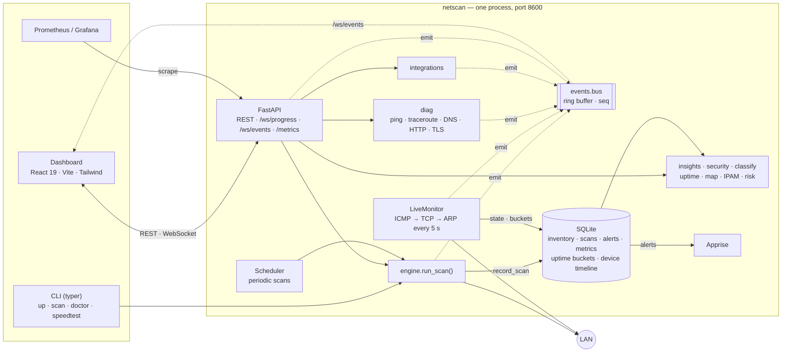
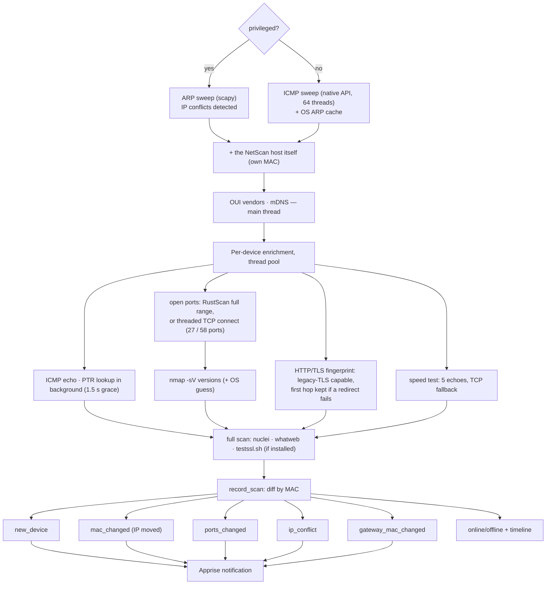

# Architecture

## Overview

### Scan pipeline

## Modules

| Module | Role |
|---|---|
| `events.py` | Process-wide event bus: bounded ring buffer (5000), monotonic `seq`, thread-safe fan-out to `/ws/events`, `info+` mirrored to `netscan.log`. `BusLogHandler` forwards warnings/errors from ordinary loggers. |
| `scanner/icmp.py` | ICMP echo without spawning processes: Windows `IcmpSendEcho`, POSIX datagram/raw sockets, `ping` as last resort; `arp_probe` (Windows `SendARP`). |
| `scanner/discovery.py` | Local network/gateway detection, ARP scan (scapy), unprivileged sweep (ICMP + neighbour table), neighbour-table parsers for Windows/Linux/BSD. |
| `scanner/engine.py` | Orchestration; resolves which stages run and why the others are skipped; emits one event per host/stage. |
| `scanner/enrich.py` · `speed.py` · `fingerprint.py` · `tools.py` · `mdns.py` | Ports, latency/jitter/loss/quality, HTTP/TLS, external tools (exact command lines on the event feed), mDNS. |
| `live.py` | Live monitor: probe chain, hysteresis state machine, 5-min uptime buckets, gateway/WAN RTT. |
| `db/store.py` | Inventory diff and persistence: devices, scans, alerts, metric samples, uptime buckets, device timeline, meta (gateway MAC). |
| `classify.py` | Role inference with reasons; MAC analysis (randomized, virtual NIC). |
| `security.py` | Risk score with itemized factors (evidence + remediation). |
| `insights.py` | Uptime report (windows, coverage, slots, outages, MTTR), network map, IP map, security report, Prometheus exposition. |
| `diag.py` | Toolbox: ping, native traceroute, RFC 1035 DNS client + resolver benchmark, TCP check, HTTP phase timing, TLS inspection, subnet and MAC calculators. |
| `api/app.py` + `routes_events.py` · `routes_insights.py` · `routes_toolbox.py` | REST/WebSocket surface. |

Frontend: `lib/eventStream.ts` (shared `/ws/events` connection with replay and
HTTP-polling fallback), `lib/telemetry.ts` (browser-side events: every API
call with status, time and size, WebSocket state, uncaught errors),
`lib/format.ts` (the single place where units are formatted), `sections/*`
(one per tab, all lazy-loaded except the shell).

## Key decisions

- **A single `engine.run_scan()`** serves the CLI and the API. Coarse progress
  goes through a `(stage, done, total)` callback (CLI progress bar, header
  progress); fine-grained detail goes to the event bus.
- **Transparency by default.** Every probe, command line, HTTP request,
  certificate, state change and API call produces an event. A stage that does
  not run says why (`skipped — nmap -sV: not installed`). Scan failures carry
  the real exception message to the dashboard instead of "see the log".
- **Degrade, don't fail.** Without admin rights the ARP scan is replaced by an
  ICMP sweep plus the OS neighbour cache — the ping attempt makes the OS ARP
  the host, so ICMP-filtering PCs still appear. Missing tools are skipped and
  reported.
- **No subprocess per probe.** The previous `ping.exe` per echo cost
  30–80 ms of process start-up on Windows (more than a LAN RTT), and its exit
  code 0 on "Destination host unreachable" counted dead hosts as alive.
- **Hysteresis for state.** Down after N failed probes, up on the first
  answer; transitions are stored once, so scans and the live monitor never
  double-alert.
- **Honest availability.** Uptime is computed only over observed time and
  always shown with its coverage; a gap is "no data", never "down".
- **Inventory diff by MAC.** The MAC is the stable key. Ports are diffed only
  within the probed set, so a quick scan after a full one does not "close"
  the extended ports; a host that answered nothing is not diffed.
- **Explained scores.** Role, quality and risk always come with the reasons
  or formula behind them (see [METRICS.md](METRICS.md)).
- **Optional external tools.** `scanner/tools.py` detects binaries with
  `shutil.which`; nothing fails because nmap is not installed.
- **Fault-tolerant integrations.** `collect_all()` isolates each instance's
  failure; HTTP clients are closed after each poll and Pi-hole sessions are
  reused (v6 caps concurrent sessions).
- **Secrets outside the repository.** pydantic-settings merges YAML + env;
  tokens live in `NETSCAN_*` variables.

## Planned extensions

- SNMP polling (interface counters, LLDP/CDP neighbours) for a real L2 topology.
- Wiring `masscan` into the engine (today it is detected but not used).
